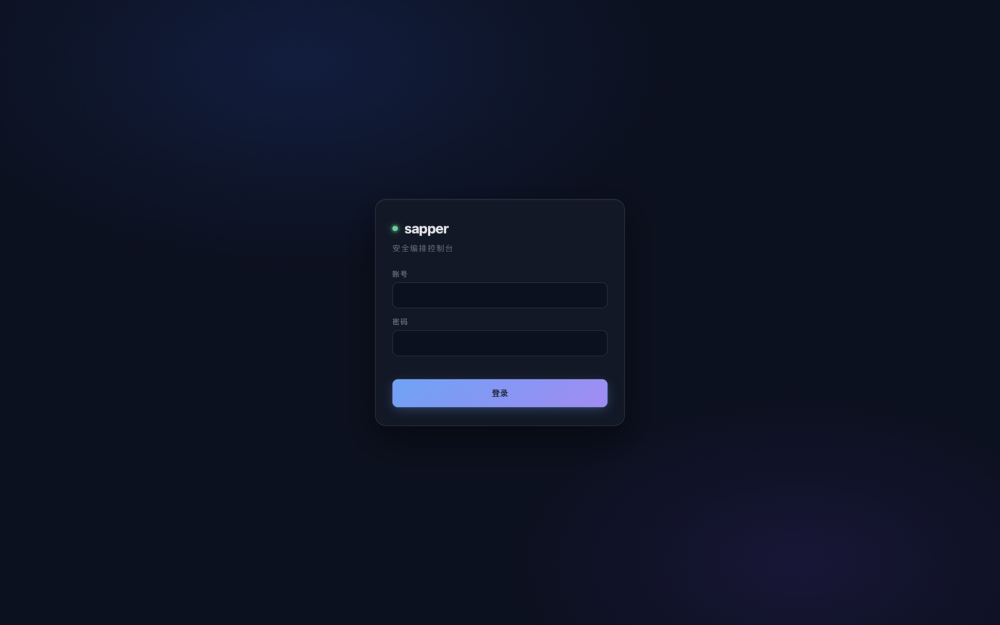
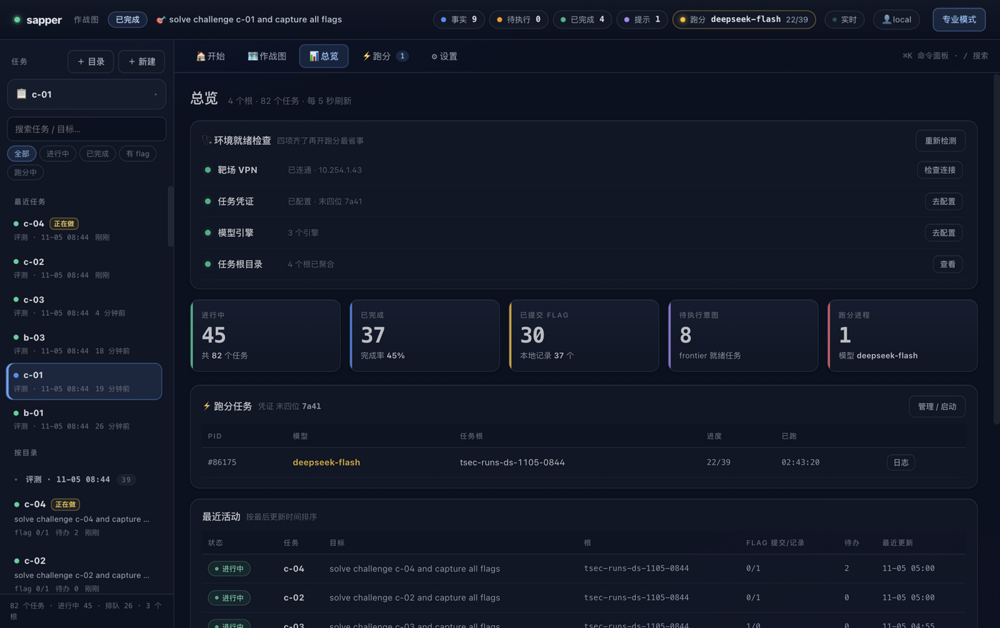
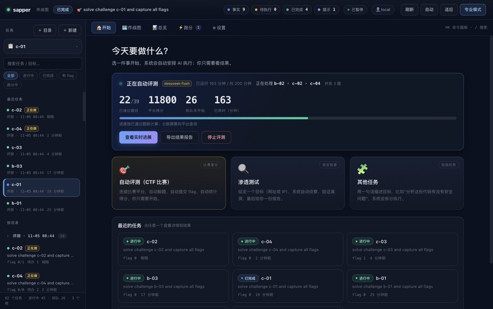
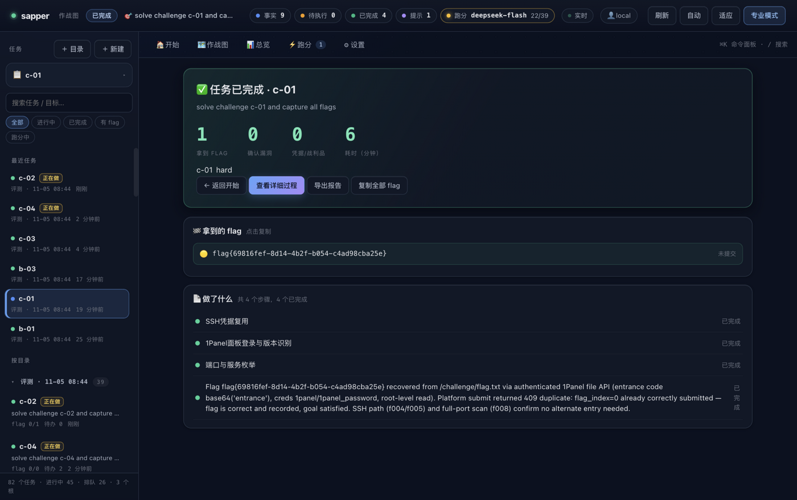
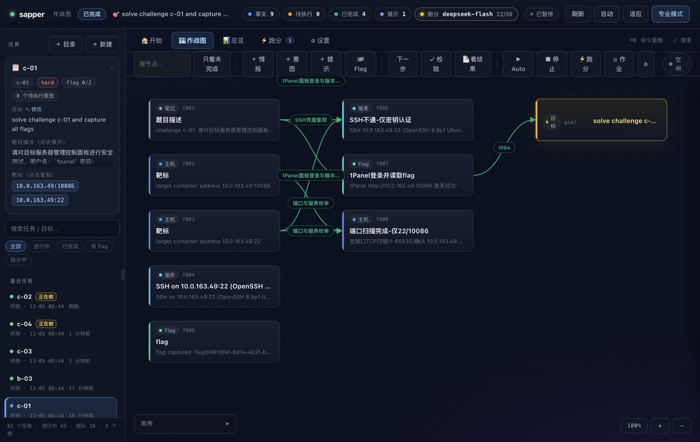

# Myrmidon

> 安全任务控制台 —— 一句话目标，AI 自动侦察、验证、取证、出报告。

本仓库是 [sapper-v2](https://github.com/N1nEmAn/sapper-v2) 的**产品化分支**：保留原项目"事实图谱 + 自主编排"的内核，重做了 Web 控制台，并补齐了**交付级能力**（登录鉴权、客户隔离、Docker 镜像、使用手册）。



## 它能做什么

| 场景 | 说明 |
|---|---|
| **比赛评测** | 对接 TSecBench / CTFd / 本地离线，批量开题、自动解题、自动提交 flag、实时看队列与得分 |
| **安全检查** | 给一个网址或 IP，AI 自动侦察、验证漏洞、取证，产出可读结论 |
| **自由任务** | 用一句话描述目标，系统拆解成步骤执行 |

## 界面

| 概览 | 任务 |
|---|---|
|  |  |

| 任务详情（结论） | 作战图 |
|---|---|
|  |  |

## 快速开始

### 方式一：Docker（推荐）

```bash
git clone <this-repo> && cd sapper-v2   # 或你的克隆目录

# 1) 构建控制台镜像（约 1.25GB）
docker build -f docker/Dockerfile.console -t myrmidon-console:1.0.0 .

# 2) 生成管理员账号
mkdir -p ./data
docker run --rm --entrypoint python3 -v ./data:/data myrmidon-console:1.0.0 \
  /app/lib/sapper.py console-user add admin --role admin \
  --password '换成强密码' --file /data/users.json

# 3) 启动
docker run -d --name myrmidon -p 127.0.0.1:8890:8890 -v ./data:/data \
  -e ANTHROPIC_BASE_URL=https://api.deepseek.com/anthropic \
  -e ANTHROPIC_AUTH_TOKEN=sk-你的key \
  myrmidon-console:1.0.0
```

打开 <http://127.0.0.1:8890>，用刚建的账号登录。

### 方式二：本机直接跑（开发）

```bash
bash install.sh                     # 安装 sapper CLI（纯标准库）
sapper console --root ./missions --port 8890
```

## 文档

- **使用手册（图文）**：[`docs/使用手册.html`](docs/使用手册.html) — 单文件，双击即看；也可打印 PDF
- **交付部署**：[`docs/交付部署.md`](docs/交付部署.md) — 账号权限、数据备份、Nginx/HTTPS、VPN 方案、**镜像打包与分发**
- **接入新比赛平台**：[`docs/新平台接入.md`](docs/新平台接入.md) — 5 个方法的适配器契约

## 与原项目的差异

- **Web 控制台重写**：页面化路由（概览/任务/跑分/设置）、任务表格（搜索/筛选/排序/分页/批量）、任务详情五页签（结论/作战图/发现/步骤/日志）
- **鉴权与隔离**：`users.json`（pbkdf2）+ 会话登录；`admin` / `viewer` 两角色，按目录授权
- **多平台适配器**：TSecBench（内置）/ CTFd / 本地离线，可通过 `provider` 切换
- **交付件**：控制台 Dockerfile、镜像分发文档、图文使用手册
- **稳定性修复**：空图死锁（自动播种起点）、跑分并发名额被幽灵容器占用（自动回收）、错误被吞（stdout 错误解析 + 默认重试）

## 许可

沿用原项目许可，见 [LICENSE](LICENSE)。
