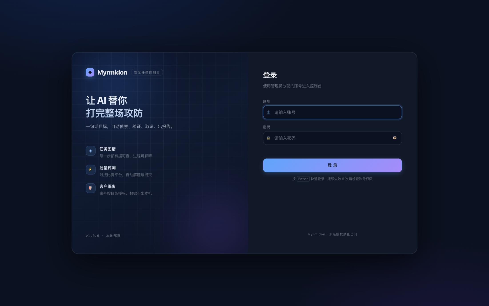
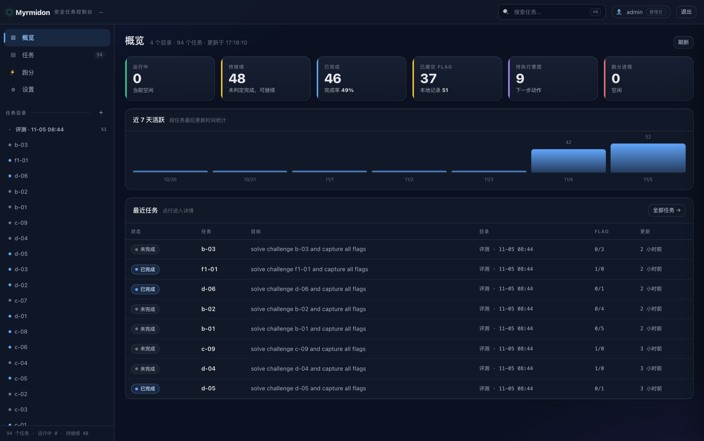
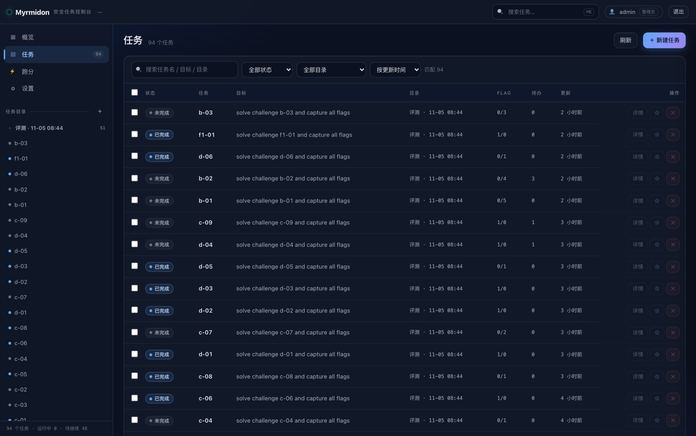
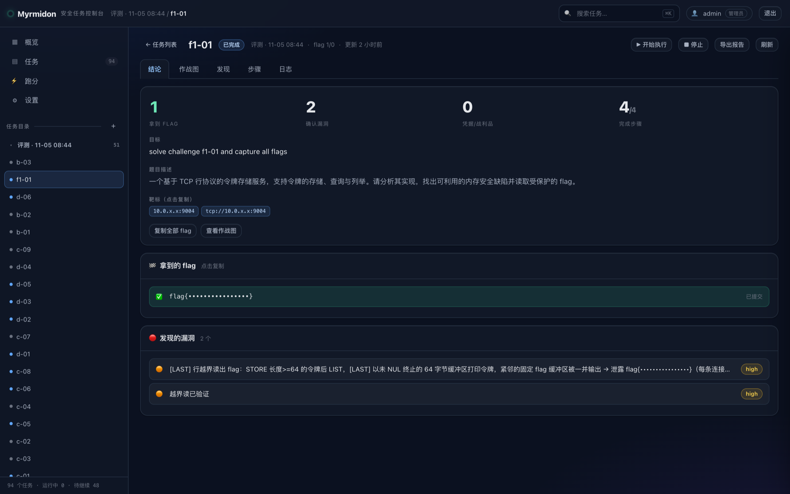
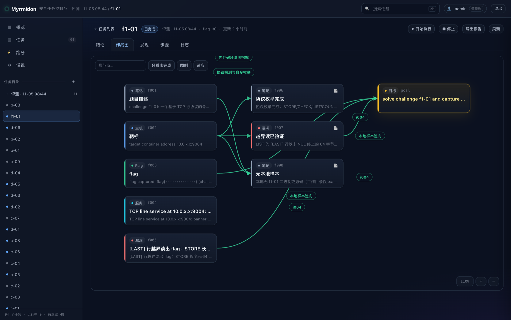
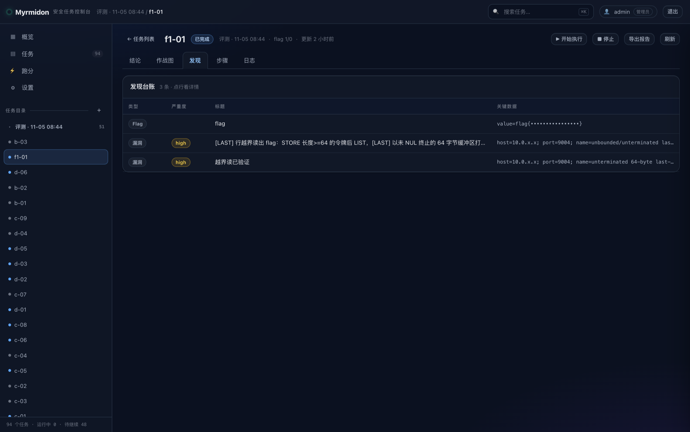
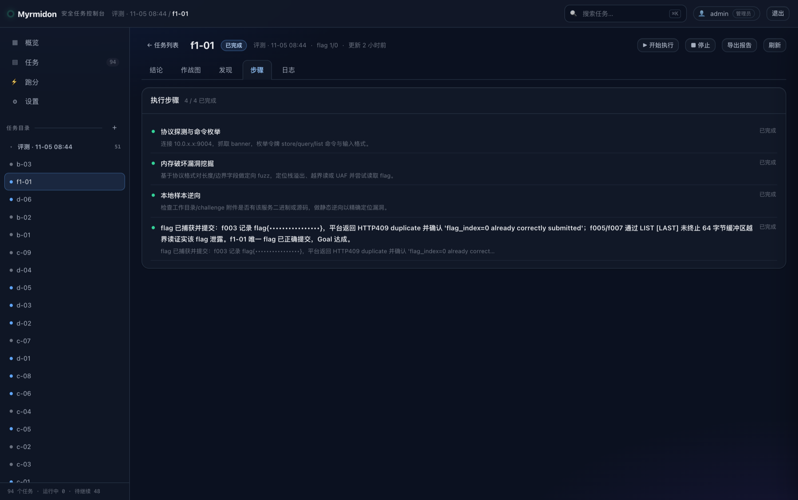
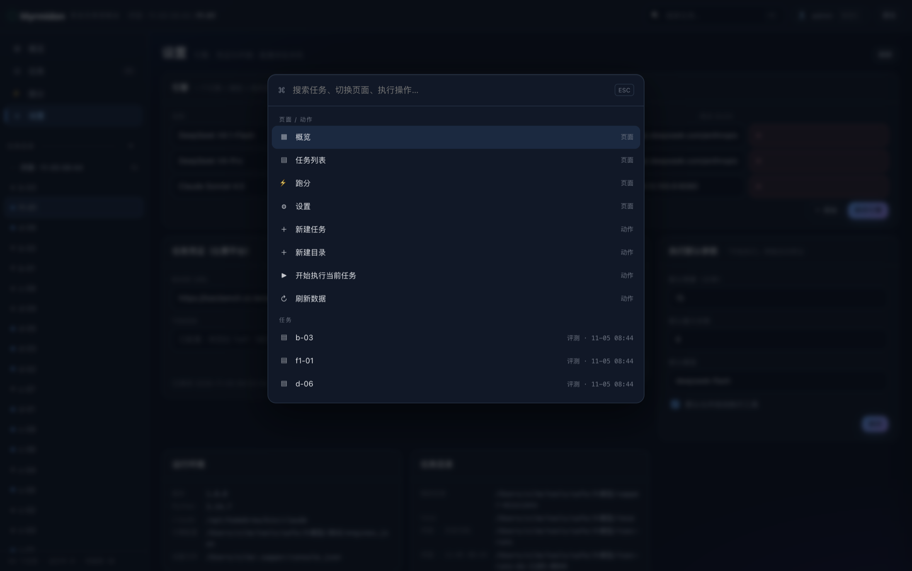
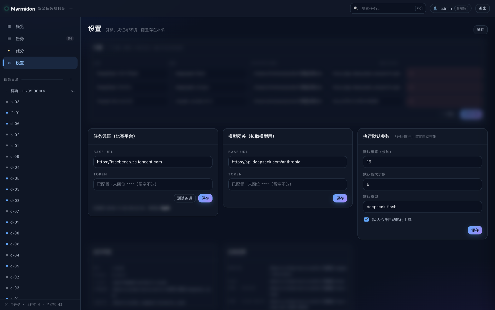

## 文档信息

| 版本 | 日期 | 修订人 | 说明 |
|---|---|---|---|
| V1.0 | 2026-11-05 | 【交付方】 | 首次交付：v1.0.0-ui 镜像、部署与验收记录 |

**适用读者**：客户方技术负责人、运维人员、安全测试人员。

**配套文档**：

| 文档 | 用途 |
|---|---|
| 《使用手册》（HTML / Markdown） | 面向使用者，图文操作指引 |
| 《交付部署手册》 | 面向运维，含 Nginx/HTTPS、VPN 接入、备份升级 |
| 《新平台接入说明》 | 面向二次开发，比赛平台适配器契约 |
| 《发布说明 v1.0.0-ui》 | 版本变更与产物校验值 |

---

## 1. 交付概述

### 1.1 产品定位

Myrmidon 是一套**面向安全测试任务的 AI 编排控制台**。使用者用一句话描述目标，系统把目标拆解为可验证的步骤，调用大模型驱动命令行工具执行，并把每一步的发现沉淀为"事实图谱"，最终形成可追溯的结论。

与"直接对 AI 下指令"相比，它解决三个问题：

- **过程可追溯**：每条结论都有来源事实与执行记录，不是一段无法核对的自然语言。
- **任务可管控**：预算（分钟/步数）、并发、模型、权限都由控制台统一约束。
- **多人可协作**：账号分角色、目录级隔离，客户之间互不可见。

::: {.callout}

**适用场景**：授权范围内的渗透测试、攻防演练、比赛评测（TSecBench / CTFd）、安全自查。
**不适用场景**：未授权的目标、需要人工实时决策的高风险变更、替代专业渗透工程师的最终判断。

:::

### 1.2 本次交付范围

| 在交付范围内 | 说明 |
|---|---|
| 控制台程序 | Web 界面、任务管理、Auto 编排、作战图、日志、发现台账 |
| 账号与隔离 | 登录鉴权（pbkdf2）、admin / viewer 两角色、目录级授权 |
| 模型接入 | 任意 Anthropic 兼容网关（含 DeepSeek 等），页面内配置与切换 |
| 平台接入 | TSecBench 原生、CTFd 适配器、本地离线题库 |
| 交付物 | 离线 Docker 镜像、源码仓库、四份文档 |
| 实测验收 | 源码安装与容器安装两条路径 + 真实模型 Auto 运行 |

| 不在交付范围内 | 说明 |
|---|---|
| 渗透工具链 | 控制台镜像不含 nmap / pwntools / nuclei；需另用 Kali 底座镜像（见 3.3） |
| 大模型账号与额度 | 由客户自行提供 API Key，费用由客户承担 |
| 比赛平台账号 | 由客户提供，交付方不代持 |
| 定制开发 | 报告模板、审计日志、SSO 等属后续版本（见第 7 章） |

### 1.3 版本与许可

- 版本号：`sapper 1.0.0`，交付标识 `v1.0.0-ui`。
- 许可证：**MIT**（衍生自开源项目 sapper-v2，保留原始版权声明）。
- 交付仓库：<https://github.com/zzhnohikari/myrmidon>（公开仓库，可直接获取源码）。

---

## 2. 交付物清单

### 2.1 交付内容

| 编号 | 交付物 | 形式 | 用途 |
|---|---|---|---|
| D-01 | 控制台镜像包 | `myrmidon-console-1.0.0-linux-amd64.tar.gz`（423,083,562 字节） | 离线部署主体，`docker load` 即用 |
| D-02 | 源码仓库 | GitHub 公开仓库 + 本地副本 | 二次开发、审计、自行构建 |
| D-03 | 《使用手册》 | 单文件 HTML（含 10 张截图）+ Markdown | 使用者培训 |
| D-04 | 《交付部署手册》 | Markdown | 运维部署与日常维护 |
| D-05 | 《新平台接入说明》 | Markdown | 对接其他比赛/靶场平台 |
| D-06 | 《发布说明 v1.0.0-ui》 | Markdown | 版本内容与校验值 |
| D-07 | 本交付报告 | Markdown / HTML / PDF | 验收依据 |

### 2.2 校验值

| 对象 | 校验值 |
|---|---|
| 镜像 tag | `myrmidon-console:1.0.0-amd64` |
| 镜像平台 | `linux/amd64` |
| 镜像 ID | `sha256:085ef36c175e7db9ffc043c3a1bfc586c54c81661d396fd92458844cce527a04` |
| 镜像大小 | 423,083,562 字节（约 404 MB） |
| 离线包 SHA256 | `57c8996a0cec087a78650b96a5fe2e69eb82eb7480c0062cc54931f70e31792f` |

**客户接收后请先核对**：

```bash
sha256sum myrmidon-console-1.0.0-linux-amd64.tar.gz
# 应为 57c8996a0cec087a78650b96a5fe2e69eb82eb7480c0062cc54931f70e31792f

docker load < myrmidon-console-1.0.0-linux-amd64.tar.gz
docker image inspect myrmidon-console:1.0.0-amd64 --format '{{.Os}}/{{.Architecture}}'
# 应为 linux/amd64
```

::: {.callout .warn}

**镜像架构必须与目标服务器一致。** 本包为 `linux/amd64`，适用于绝大多数 x86_64 云主机。
若目标机是 ARM（如部分国产化平台或 Apple Silicon），需用 `--platform linux/arm64` 重新构建，
混用会报 `exec format error`（详见 8.1 排障）。

:::

---

## 3. 部署环境要求

### 3.1 最低配置

| 项目 | 最低 | 推荐 | 说明 |
|---|---|---|---|
| CPU | 2 核 | 4 核 | Auto 本身是串行调用模型，多核主要给并发任务 |
| 内存 | 4 GB | 8 GB | 实测 2C4G 可正常运行 |
| 磁盘 | 20 GB | 50 GB | 镜像约 1.3 GB（解压后），任务数据增长取决于使用量 |
| 操作系统 | Linux x86_64（Ubuntu 22.04 实测） | 同左 | 需支持 Docker |
| Docker | 20.10+ | 24+ | 实测 29.1.3 |
| 网络 | 能访问模型网关 | 同左 | 控制台自身不需要公网入口 |

### 3.2 依赖项

| 依赖 | 是否随镜像提供 | 说明 |
|---|---|---|
| Python 3.11 | 是 | 控制台运行时（纯标准库） |
| Node.js 22 | 是 | claude CLI 运行时 |
| claude CLI 2.1.318 | 是 | 模型调用与工具执行引擎 |
| 模型网关 | 否 | 客户提供 Base URL 与 Token |
| 比赛平台令牌 | 否 | 仅比赛场景需要 |

### 3.3 工具链说明（重要）

交付的控制台镜像只包含"大脑"（编排 + 模型调用），**不含渗透测试工具**。若需要 AI 实际执行 nmap、sqlmap、nuclei 等命令，请使用仓库中的 Kali 底座镜像（`docker/Dockerfile`，约 5.3 GB），并在启动时替换镜像名。控制台代码完全一致，仅运行环境不同。

---

## 4. 部署实施

### 4.1 方式一：离线镜像（推荐）

适用于客户环境不能访问公网、或需要快速复制多套环境的场景。

```bash
# 1) 导入镜像
docker load < myrmidon-console-1.0.0-linux-amd64.tar.gz

# 2) 生成管理员账号（数据卷目录按客户规范调整）
mkdir -p /opt/myrmidon/data
docker run --rm --entrypoint python3 \
  -v /opt/myrmidon/data:/data myrmidon-console:1.0.0-amd64 \
  /app/lib/sapper.py console-user add admin \
  --role admin --password '请替换为强密码'

# 3) 配置模型网关（凭据写入独立文件，权限 600）
cat > /opt/myrmidon/model.env <<'ENV'
ANTHROPIC_BASE_URL=https://<客户网关地址>
ANTHROPIC_AUTH_TOKEN=<客户 API Key>
ENV
chmod 600 /opt/myrmidon/model.env

# 4) 启动
docker run -d --name myrmidon --restart unless-stopped \
  -p 127.0.0.1:8890:8890 \
  -v /opt/myrmidon/data:/data \
  --env-file /opt/myrmidon/model.env \
  myrmidon-console:1.0.0-amd64
```

> **`--entrypoint python3` 不可省略**：镜像默认入口是控制台启动脚本，执行一次性命令时必须覆盖。

### 4.2 方式二：源码安装

适用于需要审计代码或二次开发的场景。

```bash
git clone https://github.com/zzhnohikari/myrmidon.git
cd myrmidon
bash install.sh                                  # 安装 sapper CLI（纯标准库）
sapper console-user add admin --password '强密码'  # 首次建账号
export IS_SANDBOX=1                              # 以 root 运行时必需（见 8.1）
sapper console --root ./missions --port 8890
```

源码方式需要客户自行安装 Node.js 22 与 claude CLI（`npm i -g @anthropic-ai/claude-code`）。

### 4.3 对外访问与 HTTPS

默认只监听 `127.0.0.1`，不对外暴露。需要多人访问时，建议前置 Nginx 并启用 HTTPS：

```nginx
server {
    listen 443 ssl http2;
    server_name myrmidon.example.com;
    ssl_certificate     /etc/ssl/certs/myrmidon.crt;
    ssl_certificate_key /etc/ssl/private/myrmidon.key;

    location / {
        proxy_pass http://127.0.0.1:8890;
        proxy_set_header Host $host;
        proxy_set_header X-Real-IP $remote_addr;
    }
}
```

若测试目标位于内网，按《交付部署手册》第 6 章接入 VPN（容器旁路、宿主机路由、独立网关三种方式）。

### 4.4 上线后初始化（约 5 分钟）

1. 浏览器打开控制台，用管理员账号登录。
2. 「设置 → 模型网关」确认 Base URL / Token 正确，点「拉取模型」选择模型。
3. 「设置 → Auto 默认参数」设定默认预算（分钟）、步数、默认模型，后续新建任务不再重复填写。
4. 「设置 → 任务凭证」填写比赛平台 Token（仅比赛场景）。
5. 新建一个任务，输入目标，点「开始执行」，确认能正常产生日志与事实。

---

## 5. 验收测试记录

### 5.1 测试环境

| 项目 | 容器路径 | 源码路径 |
|---|---|---|
| 云厂商/地域 | 腾讯云 · 北京 | 同左 |
| 实例规格 | SA3.MEDIUM4（2 核 4 GB，竞价） | 同左 |
| 操作系统 | Ubuntu 22.04 | Ubuntu 22.04 |
| Docker | 29.1.3 | 29.1.3 |
| Python | 3.11（镜像内置） | 3.10.12（系统） |
| Node / claude | 22.23.4 / 2.1.318 | 22.20.0 / 2.1.318 |
| 模型 | DeepSeek（Anthropic 兼容端点） | 同左 |

### 5.2 功能验收

| 编号 | 用例 | 预期 | 实测结果 | 结论 |
|---|---|---|---|---|
| T-01 | 容器启动 | 容器 healthy | `Up (healthy)` | 通过 |
| T-02 | 健康检查 | HTTP 200 | 200 | 通过 |
| T-03 | 未登录访问接口 | HTTP 401 | 401 | 通过 |
| T-04 | 错误密码登录 | HTTP 401 | 401 | 通过 |
| T-05 | 正确账号登录 | HTTP 200 + 会话 | 200 | 通过 |
| T-06 | 创建任务 | 落盘至数据卷 | `/data/roots/<任务>` 生成 | 通过 |
| T-07 | 启动 Auto（容器） | 调通模型并产出事实 | 两轮推理，`status=completed`，5 条事实 | 通过 |
| T-08 | 启动 Auto（源码） | 同上 | 产出 `f002 源码安装已核验` | 通过 |
| T-09 | 任务状态语义 | 完成/未完成可区分 | 完成=completed，预算耗尽=active | 通过 |
| T-10 | 重启后数据保留 | 任务与图谱不丢 | 重建容器后历史任务仍在 | 通过 |
| T-11 | 镜像架构 | 与目标机一致 | `linux/amd64`，可执行 | 通过 |
| T-12 | 鉴权配置自动识别 | 账号文件生效 | 未登录 401，登录 200 | 通过 |

> 测试用例 T-07 / T-08 是本次验收的关键：前序版本在"健康检查全部通过"的情况下，Auto 实际 100% 失败，详见 5.4 缺陷 D-02。因此验收不以健康检查为终点，而以"真实模型跑完一个任务"为准。

### 5.3 Auto 运行证据（容器路径）

```
[auto] start  model=<客户模型> max_steps=2 verify=False
[auto] step 1.1 reason
[auto]        reason -> proposed intents: i001, i002
[auto] step 1.2 explore i001
[auto]        i001 concluded by the executor itself
[auto] step 1.2 explore i002
[auto]        i002 concluded by the executor itself
[auto] step 2.1 reason
[auto]        reason -> goal complete via i003
[auto] step 2: goal completed by reason
[auto] done  status=completed  explored=2
```

任务结束后图谱中有 5 条事实（含起点、模型调用链验证、落库记录等），任务状态为「已完成」。

### 5.4 交付前修复的缺陷

| 编号 | 问题 | 影响 | 修复 | 验证 |
|---|---|---|---|---|
| D-01 | 账号文件写入路径与控制台读取路径不一致 | 建了账号但控制台仍为"无鉴权"开放模式，且无报错 | 统一三级解析（命令行 > 环境变量 > 默认路径），容器入口两条路径都识别 | T-12 |
| D-02 | 容器以 root 运行时 claude 拒绝 `--dangerously-skip-permissions` | Auto 每一步都失败；健康检查、登录、建任务全部正常，极易漏检 | 镜像内置 `IS_SANDBOX=1`；引擎错误补可操作提示 | T-07 |
| D-03 | 首次导出的镜像为 `linux/arm64`（构建机架构） | 在 x86_64 服务器 `docker load` 成功但执行即 `exec format error` | 按 `linux/amd64` 重新构建并复测 | T-11 |

> 这三个缺陷都只在"真机 + 真模型"环境下才会暴露，是本报告以实测为准的原因。修复后的镜像即本次交付版本。

---

::: {.chapter-ui}
## 6. 界面与功能

控制台按"概览 → 任务 → 详情"的主线组织，全部操作在浏览器内完成，不依赖命令行。本章按使用路径逐页说明。

### 6.1 页面总览

| 页面 | 主要用途 |
|---|---|
| 概览 | 一屏看清整体态势：运行中/未完成/已完成任务数、已提交 flag、待执行意图、近 7 天活跃度 |
| 任务 | 任务清单：搜索、状态与目录筛选、排序、分页、批量置顶/删除、双击重命名 |
| 任务详情 | 单个任务的结论、作战图、发现台账、执行步骤、运行日志 |
| 跑分 | 对接比赛平台的批量解题队列与得分 |
| 设置 | 模型网关、比赛平台凭证、Auto 默认参数、引擎、账号、任务目录 |

### 6.2 登录与身份

分屏登录页：左侧说明产品能力，右侧为账号密码表单。账号由管理员创建，分 `admin`（全部权限）与 `viewer`（只读、且只能看被授权目录）两种角色。登录后右上角显示当前身份，可随时退出。



### 6.3 概览

进入后的默认页。顶部六个指标卡分别对应"当前在跑""未完成但可继续""已完成""已提交 flag""待执行意图""跑分进度"；中部为近 7 天任务活跃柱状图；底部是最近任务列表，可直接点进详情。



### 6.4 任务列表

所有任务在一张表里：状态（运行中/未完成/已完成）、任务名、目标、所属目录、flag 进度、更新时间和操作列。支持关键字搜索、按状态与目录筛选、四种排序、分页，以及勾选后批量置顶或删除。



### 6.5 任务详情：结论

详情页默认停在「结论」，给不看过程的人看结果：拿到几个 flag、确认几个漏洞、完成几步；上方是目标与题目描述（靶标地址可点击复制），下方是 flag 列表与漏洞摘要，每条漏洞带严重程度标签。



### 6.6 作战图

「作战图」把任务的全部事实画成有向图：笔记、主机、服务、漏洞、flag、目标各有颜色，边表示"由谁推导出谁"，绿色标签是意图（下一步动作）。支持拖拽平移、滚轮缩放、按关键字搜索节点、只看未完成，以及一键适应画布。这张图是"过程可追溯"的核心——任何一个结论都能顺着边回溯到它的来源事实。



### 6.7 发现台账

「发现」标签页把 flag 与漏洞整理成台账：类型、严重程度、标题、关键数据（主机、端口、参数名）。与结论页的区别是它更接近可导出的清单，便于逐条复核或转交修复。



### 6.8 执行步骤

「步骤」以时间线列出系统执行过哪些动作、每步的结论是什么、是否完成。发生争议时，这一页是复盘依据。



### 6.9 命令面板

`⌘K`（Windows 为 `Ctrl+K`）打开全局命令面板：搜任务、跳页面、新建任务或目录、对当前任务执行操作，都用键盘完成。任务多时这是最快的入口。



### 6.10 设置

设置页分六块：引擎（模型 + 网关组合，供跑分与执行时选择）、比赛平台凭证、模型网关、执行默认参数（默认预算分钟数、最大步数、默认模型、是否允许自动执行工具）、运行环境自检、任务目录管理。凭证只回显末四位，完整值不落页面。



<div class="callout">

图中引擎列表、运行环境与任务目录三块已做模糊处理，因其包含交付方本机路径与内网地址；客户环境部署后显示的是客户自己的配置。

</div>

### 6.11 任务生命周期

| 状态 | 含义 | 使用者动作 |
|---|---|---|
| 运行中 | 正在调用模型执行 | 可看实时日志，可停止 |
| 未完成 | 预算内未判定完成，进度已保留 | 追加预算后「开始执行」继续 |
| 已完成 | 目标已达成或判定完成 | 查看结论与发现，可导出 |

### 6.12 平台接入

| 平台 | 接入方式 |
|---|---|
| TSecBench | 内置适配器，填平台地址与 Token |
| CTFd | 内置适配器，填地址与 API Token |
| 本地离线题库 | 配置文件定义题目与 flag，适合演练与培训 |
| 其他 | 按《新平台接入说明》实现 5 个方法即可 |

:::

## 7. 已知限制与后续规划

### 7.1 当前版本限制

| 限制 | 影响 | 建议 |
|---|---|---|
| 无审计日志 | 无法追溯"谁在何时做了什么" | 当前依赖操作系统账号与反向代理访问日志；正式多租户环境请等待后续版本 |
| 无报告模板导出 | 结论以页面/Markdown 导出为主 | 可先用「导出」功能取 Markdown，人工整理 |
| 列表为前端分页 | 任务数达数千时列表加载偏慢 | 按目录拆分为多个任务根 |
| 控制台镜像不含工具链 | 无法直接执行 nmap 等命令 | 使用 Kali 底座镜像 |
| 单机部署 | 不支持多节点集群与任务调度 | 本次交付为单机版 |
| 目录级隔离 | 隔离粒度是任务根目录，不是行级权限 | 每个客户/项目分配独立目录 |

### 7.2 后续版本方向（不在本次交付）

- 审计日志与操作留痕
- 报告模板与一键导出（Word / PDF）
- 服务端分页与大规模任务管理
- 登录失败锁定、双因素认证、SSO
- 多节点调度与任务队列

---

## 8. 运维手册

### 8.1 常见问题排查

| 现象 | 原因 | 处理 |
|---|---|---|
| `exec format error` | 镜像架构与主机不符 | `docker image inspect` 核对；x86_64 用 amd64 包 |
| Auto 每步报 `dangerously-skip-permissions cannot be used with root` | 以 root 运行且未放行 | 容器镜像已内置 `IS_SANDBOX=1`；裸机执行 `export IS_SANDBOX=1` 或改用普通用户 |
| 登录一直失败 | 账号文件不在容器识别的路径 | 用 `--file /data/users.json` 显式指定，或确认 `/data/.sapper/users.json` |
| 页面能开但接口 401 | 未登录或会话过期（12 小时） | 重新登录 |
| 建任务提示 stale page | 控制台重启后旧页面令牌失效 | 强制刷新页面（Cmd/Ctrl+Shift+R） |
| 端口被占用 | 宿主机已有进程监听 | 换端口或停止占用进程 |

### 8.2 备份

所有状态都在数据卷（`/data`），容器本身无状态：

```bash
docker stop myrmidon
tar czf /backup/myrmidon-$(date +%F).tar.gz -C /opt/myrmidon data
docker start myrmidon
```

建议每日备份，保留 7 份。恢复时解压回原路径后启动容器即可。

### 8.3 升级与回滚

```bash
# 升级
docker load < myrmidon-console-<新版本>.tar.gz
docker rm -f myrmidon
docker run -d --name myrmidon ... <新镜像tag>      # 参数与首次部署一致

# 回滚：换回旧 tag 启动即可，数据结构向后兼容
```

### 8.4 日常检查

| 项目 | 命令 | 期望 |
|---|---|---|
| 容器状态 | `docker ps --filter name=myrmidon` | `Up (healthy)` |
| 健康检查 | `curl -s http://127.0.0.1:8890/api/health` | `{"ok": true, ...}` |
| 磁盘余量 | `df -h /opt/myrmidon` | 使用率 < 80% |
| 日志 | `docker logs --tail 200 myrmidon` | 无持续报错 |

### 8.5 账号管理

```bash
# 新增只读账号，仅能看指定目录
docker exec myrmidon sapper console-user add clientA \
  --role viewer --roots 'client-a' --password '强密码' --file /data/users.json

# 查看
docker exec myrmidon sapper console-user list --file /data/users.json

docker restart myrmidon
```

---

## 9. 安全与合规

### 9.1 授权边界

本系统是安全测试工具，**仅可在获得书面授权的目标上使用**。客户应在每次任务前确认：

- 目标资产在授权范围内（域名、IP、端口清单）；
- 测试时间窗与禁止操作（如禁止删改数据、禁止拒绝服务）；
- 数据留存与销毁要求。

### 9.2 交付安全措施

| 措施 | 说明 |
|---|---|
| 默认不对外暴露 | 容器只监听 `127.0.0.1`，需显式配置反向代理才可外部访问 |
| 密码存储 | pbkdf2-sha256（12 万轮）加盐哈希，不存明文 |
| 会话 | HttpOnly + SameSite=Lax Cookie，12 小时过期 |
| 写操作校验 | 每次启动生成一次性写入令牌并注入页面，防跨站提交 |
| 凭据隔离 | 模型 Key 存放于独立环境文件（权限 600），不写入镜像、不入库 |
| 镜像无默认口令 | 首次部署必须显式创建账号 |

### 9.3 客户侧责任

1. 首次登录后立即修改初始密码，并为每位使用者分配独立账号；
2. 妥善保管模型网关 Key 与比赛平台 Token，定期轮换；
3. 对外提供访问时启用 HTTPS，并限制来源 IP；
4. 按内部制度保留与清理任务数据（数据位于 `/opt/myrmidon/data`）。

---

## 10. 验收结论

### 10.1 结论

本次交付的 Myrmidon v1.0.0-ui 在指定测试环境完成部署，**12 项功能用例全部通过**，并在容器与源码两种部署方式下各完成一次真实模型驱动的 Auto 任务，产出可核对的事实记录。交付物、文档、校验值齐备。

### 10.2 验收确认

| 项目 | 结论 | 备注 |
|---|---|---|
| 交付物完整性 | □ 通过 □ 不通过 | |
| 部署可用性 | □ 通过 □ 不通过 | |
| 功能符合性 | □ 通过 □ 不通过 | |
| 文档完整性 | □ 通过 □ 不通过 | |
| 安全要求 | □ 通过 □ 不通过 | |

::: {.sign}

| 角色 | 签字 | 日期 |
|---|---|---|
| 交付方负责人 | | |
| 客户方负责人 | | |
| 客户方运维 | | |

:::

---

## 附录 A：命令速查

```bash
# 导入与查看
docker load < myrmidon-console-1.0.0-linux-amd64.tar.gz
docker image inspect myrmidon-console:1.0.0-amd64 --format '{{.Os}}/{{.Architecture}}'

# 创建账号
docker run --rm --entrypoint python3 -v /opt/myrmidon/data:/data \
  myrmidon-console:1.0.0-amd64 /app/lib/sapper.py console-user add admin \
  --role admin --password '强密码'

# 启动 / 停止 / 重启
docker run -d --name myrmidon --restart unless-stopped \
  -p 127.0.0.1:8890:8890 -v /opt/myrmidon/data:/data \
  --env-file /opt/myrmidon/model.env myrmidon-console:1.0.0-amd64
docker stop myrmidon && docker start myrmidon

# 健康检查与验收
curl -s http://127.0.0.1:8890/api/health
curl -s -o /dev/null -w '%{http_code}\n' http://127.0.0.1:8890/api/missions   # 期望 401

# 备份
tar czf /backup/myrmidon-$(date +%F).tar.gz -C /opt/myrmidon data
```

## 附录 B：端口与目录

| 项目 | 默认值 | 说明 |
|---|---|---|
| 服务端口 | 8890 | 仅监听 127.0.0.1 |
| 数据目录 | `/data`（容器内） | 挂载到宿主机 `/opt/myrmidon/data` |
| 账号文件 | `/data/.sapper/users.json` | 或 `--file` 指定的路径 |
| 任务根目录 | `/data/roots` | 每个子目录一个任务 |
| 作业日志 | `/data/roots/.console/jobs` | Auto / 跑分任务日志 |
| 全局设置 | 容器内 `/data/.sapper/console.json` | 网关、默认参数等 |

::: {.appendix-c}
## 附录 C：交付检查清单

::: {.checklist}
- □ 离线镜像包已核对 SHA256
- □ `docker load` 后架构为 `linux/amd64`
- □ 管理员账号已创建，初始密码已修改
- □ 模型网关连通，模型列表可拉取
- □ 未登录访问 `/api/missions` 返回 401
- □ 新建任务可执行并产生事实
- □ 已配置数据备份策略
- □ 已确认对外访问方式（本机 / VPN / HTTPS 反向代理）
- □ 使用者已接受《使用手册》培训
- □ 验收确认页已签字
:::
:::
